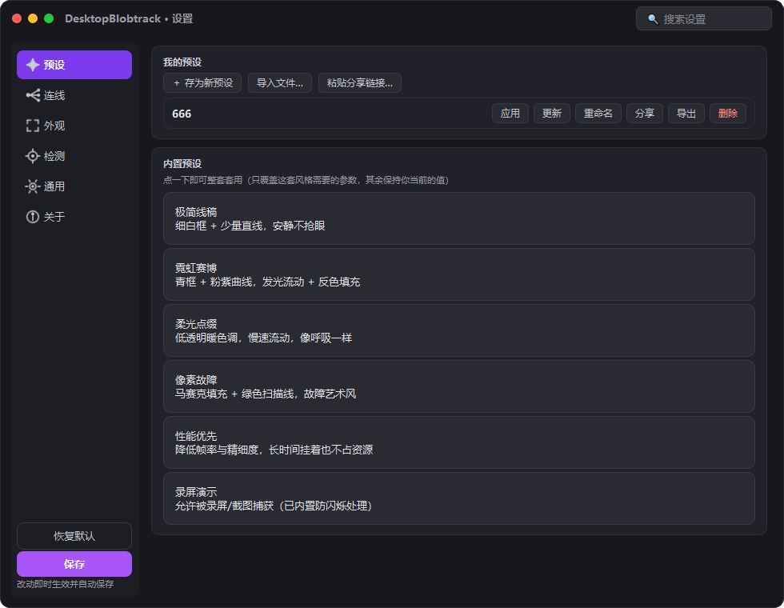
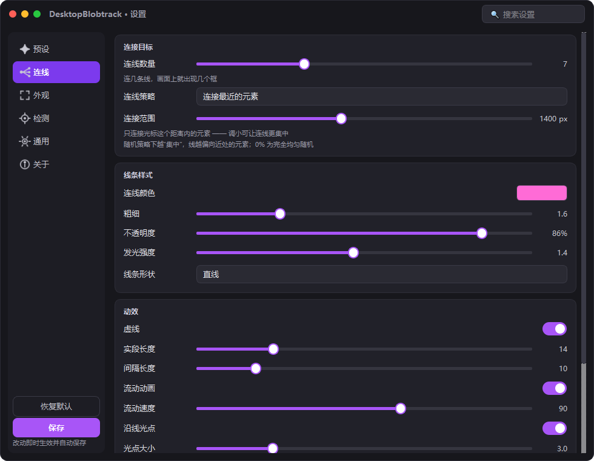
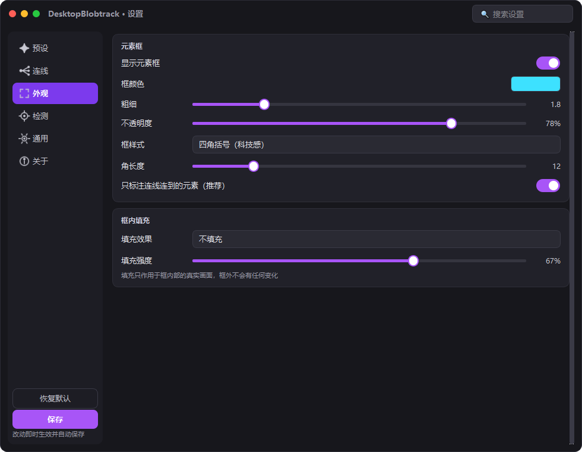
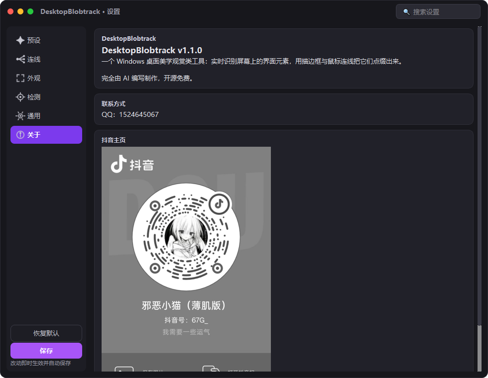

# DesktopBlobtrack —— Windows 桌面美学观赏工具

一个纯观赏性的桌面特效引擎：以低帧率实时截屏，用**斑点检测**自动识别屏幕上的界面元素（图标、按钮、窗口区域等），在它们周围绘制发光描边框，并从鼠标位置向元素中心发射流动的霓虹连线。覆盖层**全屏透明置顶、鼠标完全穿透**，绝不影响正常操作。


## 界面预览

| 预设 | 连线 |
|---|---|
|  |  |
| **外观** | **关于** |
|  |  |

---

## 功能总览

| 需求 | 实现 |
|---|---|
| 实时屏幕捕获 | mss 后台线程截屏，默认 12 FPS（1–30 可调），多显示器支持 |
| 只画连线的框 | **默认行为**：只有被连线连接到的元素才画框，没连到的一律不出现 —— 画面上的框数由“连线数量”直接控制 |
| 光标区域蒙版 | 可选功能（默认关闭）：只截取/检测光标周围 960×640 画面，进一步聚焦范围并降低 CPU |
| 斑点检测 | Canny + 形态学 + 连通域轮廓（默认）/ SimpleBlobDetector 两种算法。对齐 TouchDesigner Blob Track TOP 的概念：最小/最大元素（Min/Max Blob Size）、**最小间距**（Delete Nearby：距离太近只留大者）、稳定度三档（追踪抖动过滤）、检测精细度（降分辨率提速） |
| 描边框 | 四角括号 / 矩形 / 圆角 / 圆点四种样式，颜色、粗细、透明度可调；**框严格等于检测结果**，不做任何插值动画 |
| 框内填充效果 | 反色（负片）/ 调色（色相·鲜艳·明暗，可逐框彩虹渐变）/ 纯色 / 黑白 / 复古棕黄 / 边缘线稿 / 马赛克，**严格只填充在框内部**（QPainter 裁剪保证框外零泄漏），后台线程逐帧计算 |
| 连线动画 | 鼠标为起点，1–20 条连线到最近/随机/混合元素中心。**全参数开放**：数量、策略、连接范围、**集中程度**（随机模式下偏向近处元素的程度，0%=完全均匀）、颜色、粗细、不透明度、发光、直线/曲线、弯曲度、虚线实段/间隔、流动速度、沿线光点、光标光环 |
| 可视化面板 | 深色 macOS 风格：无边框圆角窗口 + 红绿灯圆点（关闭/全屏/最小化）+ 左侧图标导航（预设 / 连线 / 外观 / 检测 / 通用 / 关于）+ 搜索筛选 + 卡片分组 + 紫色高亮；跟当前模式无关的控件自动隐藏；改动即时生效并自动保存 |
| 预设 | 内置 6 套预设（极简线稿 / 霓虹赛博 / 柔光点缀 / 像素故障 / 性能优先 / 录屏演示）一键套用；支持**新增 / 改名 / 覆盖更新 / 删除自定义预设**，并可用**导出文件 / 导入文件 / 分享链接**（`dbt-preset:` 开头的编码链接，完整包含名称与全部参数）分享 |
| 修改颜色 | 自绘取色器：SV 色板 + 色相条 + 新旧色实时对比 + HEX 输入 + R/G/B 数值 + 常用/最近使用色板 + 取消/确定，风格与整体一致 |
| 窗口行为 | 无边框透明置顶、不抢焦点、`WS_EX_TRANSPARENT` + Qt 双保险点击穿透、`Ctrl+Alt+A` 显隐、关闭即托盘 |
| 系统托盘 | 显隐 / 设置 / 保存配置 / 重载配置 / 重启捕获 / 关于 / 退出 |
| 性能 | 捕获线程与渲染线程解耦，检测前缩放 50%，蒙版模式下实测单帧 <10ms；Qt 双缓冲无闪烁；异常自动降级并只弹托盘通知 |
| 防自反馈 / 稳定性 | 默认 `SetWindowDisplayAffinity(WDA_EXCLUDEFROMCAPTURE)`（绕过分层窗口限制）+ 蒙版位置吸附 + 框坐标吸附 + NMS 量化排序 + 连续帧确认：静止画面下实测每帧变化的框 ≤0.5 个 |
| 录屏模式稳定性 | 允许被录屏/截图捕获时自动进入“录屏模式”：冻结流动虚线/光点/光环脉动等持续动效，并把“屏幕上真实画着的框与连线”用上一帧干净画面精准回填抹除——实测静止画面下每帧新增/消失的框由 ~23 个压到 ~1 个，与正常模式几乎一致 |

## 技术栈

- **Python 3.10+**（开发验证于 3.13）
- **PySide6 (Qt6)** —— 透明置顶窗口、QPainter 绘制、设置面板、托盘
- **mss** —— 极速屏幕捕获（GDI，无需管理员）
- **OpenCV (opencv-python-headless) + NumPy** —— 边缘/斑点检测
- **ctypes 直调 Win32 API** —— 点击穿透、捕获排除、DPI、光标、快捷键（无需 pywin32）

## 项目结构

```
desktop-aura/
├── aura/                    # 主程序包
│   ├── main.py              # 入口：装配所有组件、单实例守卫、退出流程
│   ├── config.py            # 配置数据类 + JSON 读写 + 参数校验
│   ├── capture.py           # 截屏+检测工作线程（QThread）
│   ├── detector.py          # 斑点检测算法（contour / simpleblob）
│   ├── tracker.py           # 跨帧 IoU 匹配 + 指数平滑（防抖防闪烁）
│   ├── display.py           # 多显示器坐标系换算（捕获/物理/逻辑三套坐标）
│   ├── overlay.py           # 全屏透明置顶覆盖层 + 全部绘制逻辑
│   ├── settings_panel.py    # 可视化设置面板（外观/检测/其他，实时生效）
│   ├── tray.py              # 系统托盘（图标为程序化绘制，无外部资源）
│   ├── hotkey.py            # 全局快捷键（GetAsyncKeyState 轮询）
│   └── win32_utils.py       # Win32 API 封装
├── tools/
│   ├── make_icon.py         # 生成 assets/aura.png + aura.ico（无需 Pillow）
│   ├── smoke_test.py        # 冒烟测试（16 项，无 GUI 依赖）
│   ├── shoot_ui.py          # 离线截取设置中心各页面（视觉检查）
│   ├── diag_flicker.py      # 录屏模式闪烁离线回放诊断
│   └── diag_flicker_live.py # 录屏模式闪烁实机诊断
├── assets/                  # 图标 + 关于页的抖音主页图（douyin.jpg）
├── build.spec               # PyInstaller 打包配置
├── build.bat                # 一键打包脚本（file/dir 两种模式）
├── run.bat                  # 开发模式一键启动（自动建 venv 装依赖）
├── requirements.txt
└── README.md
```

## 安装与启动

### 方式一：一键脚本（推荐）

```bat
cd desktop-aura
run.bat
```

首次运行自动创建 `.venv` 并安装依赖（约 1–3 分钟），之后直接启动。

### 方式二：手动命令

```bat
python -m venv .venv
.venv\Scripts\python.exe -m pip install -r requirements.txt
.venv\Scripts\python.exe -m aura.main
```

启动后即生效。常用命令行参数：

```
python -m aura.main --settings   启动同时打开设置面板
python -m aura.main --reset      恢复默认配置后启动
python -m aura.main --hidden     启动后隐藏覆盖层（仅托盘）
```

## 快捷键（可在“其他”标签页修改）

| 快捷键 | 功能 |
|---|---|
| `Ctrl + Alt + A` | 显示 / 隐藏覆盖层（隐藏时捕获线程暂停，CPU 归零） |
| `Ctrl + Alt + S` | 打开 / 关闭设置面板 |
| `Ctrl + Alt + Q` | 退出程序 |

配置文件位置：`%APPDATA%\DesktopBlobtrack\config.json`
运行日志位置：`%APPDATA%\DesktopBlobtrack\blobtrack.log`

## 打包为独立 exe

```bat
build.bat          :: 单文件模式 -> dist\DesktopBlobtrack.exe（约 90-120MB，最易分发）
build.bat dir      :: 目录模式   -> dist\DesktopBlobtrack\DesktopBlobtrack.exe（启动快 2-5 倍）
```

脚本自动完成：创建 venv → 装依赖 → 装 PyInstaller → 生成图标 → 跑冒烟测试 → 打包。

打包产物**不依赖任何 Python 环境**，可拷贝到任意 Win10/11 x64 机器直接运行。

> 单文件 exe 首次启动需解压到临时目录（约 3–8 秒属正常）；若追求秒开请用 `build.bat dir` 的目录版。

## 参数调优速查

| 症状 | 建议 |
|---|---|
| **框在闪 / 一组一组跳** | ① 确认“覆盖层不被截屏捕获”为开启（否则会自反馈，见 FAQ 6）；② 检测页“框的稳定度”选“稳定” |
| **框在缓慢移动/缩放（有缓动感）** | 默认已无任何插值（框严格等于检测结果）。若改过配置文件里的 smooth，改回 0 |
| **看到两层/两种框** | 默认不会出现。若改过配置文件里的 `highlight_new`，改回 `false` |
| 想少画框 / 太乱 | 默认只画被连线连接到的框：直接调小外观页“连线数量” |
| 想画出全部检测到的框 | 外观页关闭“只标注连线连到的元素” |
| 只想看光标附近 | 检测页“范围”选“只看光标周围”，并调整“范围大小” |
| 检测框太少（漏检） | 检测页“灵敏度”调高，或“最小元素”调小 |
| 噪声框太多 | “灵敏度”调低，或“最小元素”调大 |
| 想只框大窗口 | “最小元素”拉到 20000+ |
| 想要炫酷填充 | 外观页“填充效果”选“调色”并开彩虹渐变，或“反色”；配合框颜色食用 |
| CPU 偏高 | 检测页“检测帧率”降到 8–10、“检测精细度”降到 0.3，填充效果选“不填充” |
| 连线太乱 / 太分散 | 连线页调小“连线数量”、调小“连接范围”；随机策略下把“集中程度”调高 |
| 想让连线更分散 | 连线页“连线策略”选随机，把“集中程度”调低（0% = 全屏均匀随机） |
| 框挤成一团 | 检测页调大“最小间距”（如 40–80 px） |
| 想更炫 | 外观页“发光强度”2.0+、线条形状选“曲线”、开“虚线流动动画” |

## 常见问题排查（FAQ）

**1. 录屏 / 截图里为什么看不到特效？**
- 这是**故意的默认行为**：覆盖层默认被 `WDA_EXCLUDEFROMCAPTURE` 排除在所有屏幕捕获之外，否则它会把自己画出的框当作“屏幕上的新元素”再检测一遍，造成框不停闪变的反馈回路；副作用就是 OBS、系统截图、屏幕共享里统统看不到它。
- 想录制：设置面板 → **通用**页 → “录屏与截图”里打开 **“允许被录屏 / 截图捕获”**（或直接用“录屏演示”预设）。开启后程序自动进入“录屏模式”：冻结所有持续动效，并把自绘内容从检测输入里精准抹除，录制画面稳定不闪屏。

**2. 覆盖层不显示 / 不置顶？**
- 看托盘图标是否在运行；按 `Ctrl+Alt+A` 切换。
- 部分“游戏加速器/全屏独占游戏”会盖住普通置顶窗口，属系统限制。
- 若以管理员权限运行了其他置顶软件，请对本程序也右键“以管理员身份运行”。

**3. 覆盖层挡住了我的操作？**
- 默认开启鼠标穿透，理论上绝无影响。若曾关闭“鼠标点击穿透”，请用 `Ctrl+Alt+S` 打开设置重新勾选，或直接删除 `%APPDATA%\DesktopBlobtrack\config.json` 恢复默认。
- 实在卡死：任务管理器结束 `DesktopBlobtrack.exe` / `python.exe`。

**4. 检测不到任何元素 / 框不动？**
- 框的位置由屏幕内容决定：桌面完全静止时框自然不动（不是卡死）。移动鼠标、切换窗口即可看到框实时变化。
- 其他页勾选“左上角显示运行状态”，`live xxx ms` 是捕获心跳（正常应 < 100ms 且持续跳动）；`blobs` 是当前帧检出数。
- blobs 恒为 0：检测页“灵敏度”调到 8–10、“最小元素”调到 100、“检测精细度”调到 0.7 再试。
- 使用 DRM 保护内容（Netflix 等）全屏播放时截屏为黑屏，属正常限制。

**5. CPU / 内存占用高？**
- 内存 ~250MB 主要来自 OpenCV/Qt 运行库，属正常。
- CPU 高：按“参数调优速查”降低帧率/缩放；隐藏覆盖层（`Ctrl+Alt+A`）后捕获线程会完全暂停。

**6. 框一直在闪？**
- **默认模式下**先确认“通用”页“允许被录屏/截图捕获”是关闭的（即覆盖层不被捕获）。覆盖层是透明分层窗口，Windows 默认仍会被 `BitBlt` 抓进截图，于是程序会把自己画的框当成新元素再检测一遍，形成反馈回路。程序通过临时摘除 `WS_EX_LAYERED` 的方式绕过系统限制，成功设置 `WDA_EXCLUDEFROMCAPTURE`（可在 HUD 或 `%APPDATA%\DesktopBlobtrack\blobtrack.log` 确认）。
- **录屏模式下**（允许被捕获）：程序已自动冻结持续动效并抹除自绘内容，静止画面下每帧新增/消失的框约 1 个；若仍轻微抖动，检测页“框的稳定度”选“稳定”。

**7. 高分屏（150%/200% 缩放）下框的位置偏移？**
- 程序自动做了 DPI 换算，一般无需处理。若仍偏移，右键 exe → 属性 → 兼容性 → 更改高 DPI 设置 → 勾选“替代高 DPI 缩放行为”为“应用程序”。

**8. 多显示器有一块没框 / 框错位？**
- 程序默认捕获“全部显示器”。混用不同缩放率的显示器时，请在检测页把“显示器”切换为具体某一块。
- 拔插显示器后 3 秒内自动重新适配，无需重启。

**9. 快捷键无效？**
- 可能与其他软件（输入法、截图工具）冲突，改用别的组合（如 `ctrl+shift+q`）。
- 修改后需按回车生效。

**10. 打包报错 / 杀毒软件误报？**
- PyInstaller 单文件 exe 常被误报，可加入白名单或改用 `build.bat dir` 目录版。
- 打包失败先删除 `build/`、`dist/` 后重试；仍失败请把报错与 `pyinstaller --version` 一起反馈。
- 若提示缺 Qt 模块，编辑 `build.spec` 的 `excludes` 列表，移除报错中提到的模块名。

**11. 想开机自启？**
- `Win + R` → `shell:startup` → 把 `DesktopBlobtrack.exe` 的快捷方式放进去，并在参数加 `--hidden`。

**12. 程序行为异常？**
- 查看日志 `%APPDATA%\DesktopBlobtrack\blobtrack.log`；删除 `config.json` 可排除配置问题。
- 托盘菜单提供“重新开始屏幕捕获”，无需重启程序。

## 设计说明（为什么这样做）

- **只画被连线的框**：描边框与连线共用同一份目标挑选结果，因此“画出来的框”永远等于“正在连线的元素”。默认 `only_connected` 开启，屏幕上最多只出现 `连线数量` 个框，杂乱的元素不会被框出来。
- **光标区域蒙版（可选，默认关闭）**：开启后只捕获光标周围画面，进一步聚焦范围并降低 CPU；蒙版位置吸附到固定网格，光标小幅移动时画面逐像素一致，框不会随漂移而抖动。
- **填充严格限于框内**：捕获线程为每个检测框生成“框内画面 + 效果”贴图并带上源索引；覆盖层只给“本帧真正画出来的框”填充（填充数 == 绘制数，实测 7/7），且每次绘制都加裁剪路径——**框外保证零泄漏**（像素级断言：框内 6400 采样点 / 框外泄漏 0）。因覆盖层被 `WDA_EXCLUDEFROMCAPTURE` 排除在截屏之外，处理结果不会被二次检测，无反馈回路。
- **渲染/捕获解耦**：捕获线程 12fps 做重活，UI 线程 30fps 只画线，画面流畅但 CPU 低。
- **检测前缩放**：1920×1080 缩到 50% 后 Canny+轮廓仅 ~7ms；面积阈值按缩放比例自动换算，用户始终用“屏幕像素”思维调参。
- **稳定性优先于“动感”**：默认不做任何插值动画 —— 框严格等于当前帧检测结果（平滑=0），并通过坐标吸附、量化排序、连续帧确认在源头消除抖动，而不是用缓动把结果往后拖。
- **UI 永不阻塞**：托盘菜单的所有操作都不等待捕获线程（隐藏/重启实测 3–20ms，此前阻塞最多 2 秒）。捕获线程可安全重启动（每轮进入时清空停止标志）。
- **异常隔离**：捕获线程所有异常就地捕获并降级（连败 60 次才暂停），GUI 线程永不因屏幕问题卡死；退出时保存配置。
- **录屏模式的自绘抹除**：允许被捕获时，覆盖层会在每次绘制后把“实际画出的框 + 连线 + 光环”换算到捕获坐标并上报；捕获线程据此在检测输入上把对应像素回填为上一帧的干净画面（羽化过渡，不产生新边缘）。配合动效冻结与坐标吸附，反馈回路被彻底切断——实测静止画面下每帧新增/消失的框从 ~23 个降到 ~1 个。

## 关于

DesktopBlobtrack 是一个**桌面美学观赏类工具**，**完全由 AI 编写制作**，开源免费。设置面板 → “关于”页内有联系方式（QQ：1524645067）与作者抖音主页入口。

## 许可

[MIT](LICENSE) © 2026。依赖库各自遵循其开源协议（PySide6 LGPL / OpenCV Apache-2.0 / mss MIT 等）。
